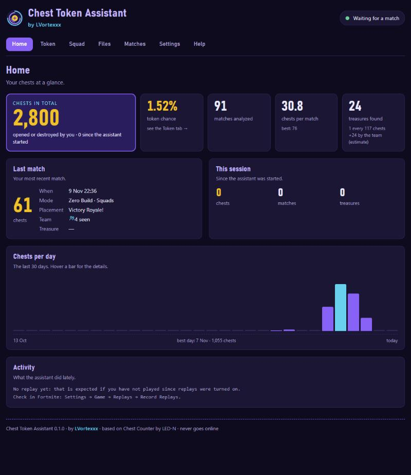
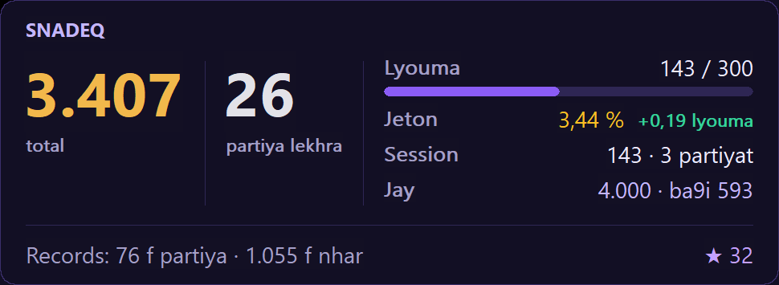
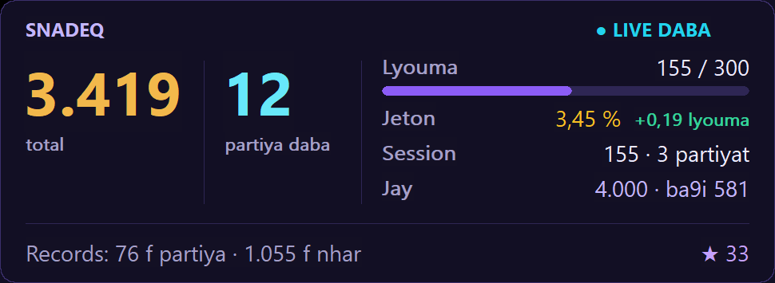

<div align="center">

[English](README.md) · [Français](README.fr.md) · **Darija** · [Español](README.es.md)


# Chest Token Assistant

**Kay7seb snadeq dyalek f Fortnite w kay9ollek zher dyalek l79i9i bach tchedd l'jeton dyal l7anout dyal l9ersan.**

*dyal LVortexxx · version 0.1 · Windows 10 / 11 · fabor · 3emmro ma kaydkhol l Internet*

[](https://github.com/LVortexxx/ChestTokenAssistant/releases/latest)



</div>

---

## Chno kaydir

- 📦 **Kay7seb kol sndouq 7llito**, chi chwiya d les secondes men b3d kol partiya (w snadeq li 7ellou s7abek 9rib lik).
- 🎯 **Kay7seb zher dyalek f l'jeton dyal l7anout dyal l9ersan** w f knouz dyal ssimana.
- ✅ **Liste dyal ga3 l7wayej li t9der trbe7** (ssimana 1, ssimana 2, saison kamla), kaytcochaw bo7dhom mlli kaybanou f les replays dyalek.
- 👥 **L7sab exact dyal l'squad**: tbeddel fichier sghir m3a s7abek.
- 🖥️ **Kolchi f fenêtre wa7da** b les onglets, w overlay sghir fo9 le jeu.
- 🌍 **4 d les langues**: français, English, darija w español.

## Bach tbda

1. F Fortnite, 7ell **Paramètres → Jeu → Rediffusions → Enregistrer les rediffusions**.
2. Telecharger **`ChestTokenAssistant.exe`** mn [la dernière version](https://github.com/LVortexxx/ChestTokenAssistant/releases/latest) w lancih (walou ma t'installi). Ila 9alek Windows *«Windows a protégé votre ordinateur»*: *Informations complémentaires → Exécuter quand même*.
3. Jawb 3la 4 d les questions sghar f la fenêtre li kat7ell. Safi: khellih khdam w nta kat'joui.

> Ila sddti la fenêtre **ma kaywe9fch**: kayb9a y7seb 7da sa3a (icône dyal l'jeton). Click 3la l'icône bach t3awed t7elha.

## Tableau de bord

| Onglet | F ster wa7ed |
|---|---|
| **Dar** | Snadeq dyalek f nadra wa7da: total, zher dyal l'jeton, partiya lekhra, l'objectif dyal lyouma, snadeq f nhar, w tswira dyal les stats t7ettha f Discord. |
| **Jeton** | Zher dyalek f l'jeton, knouz dyal ssimana, w ch7al mn sndouq khass l kol objectif. |
| **L7wayej** | Kol 7aja t9der trbe7ha, b tswirtha, zher dyalha w zher dyalek; coche dakchi li jak (kaytsejjel). |
| **Squad** | Exporti l'fichier dyalek, importi dyal s7abek, w chouf les squads dyalkom b l7sab exact dyal kol wa7ed. |
| **Fichiyat** | Kol fichier dyal sa7bek importiti, w chno kaybeddel. |
| **Partiyat** | Kol partiya, les types dyal snadeq, knouz li l9iti. |
| **Réglages** | Logha, l'objectif dyal nhar, l'overlay, chno kayt7seb f zher, Sa3at l'kenz, t7ell m3a Fortnite. |
| **3awni** | Kifach khdam, dossier dyal les données, les crédits. |

Kol jouz7 f kol onglet 3ndo chr7 f ster wa7ed ta7t l'3onwan dyalo.

## Wach mamoun?

- ✅ **Kay9ra ghir** les replays li kaysejjel Fortnite. Ma kaybeddel walou f le jeu, w ma kaydkhol l la mémoire dyalo.
- ✅ **3emmro ma kaydkhol l Internet**. Tableau de bord page kaywerriha l'assistant ghir l PC dyalek (adresse `127.0.0.1` b lien sirri): 7ta 7aja barra PC dyalek ma t9der twselha.
- ✅ **Khfif**: priorité basse, na3es bin les partiyat.

## Tafasil kter

<details>
<summary><b>Les fichiers dyal l'squad</b>: kifach tpartagi, w chno fihom</summary>

1. **Onglet Squad → Exporti l'fichier dyali**: `smitek-date.chesttoken` kayban f le Bureau. Siftou l squad dyalek (Discord…).
2. **Importi dyalhom**: double-clic 3la l'fichier li siftou lik, wla jerro l tableau de bord.
3. Kaytkhllaw ghir les partiyat li l3btou **m3a ba3d f nefs l'équipe**. L7sab dyalhom kay3wwed dakchi li chafo le replay dyalek: walou ma kayt7seb jouj mrat.

**Chno f l'fichier:** smitek w l'id Epic dyalek, w l kol partiya f l'équipe l'id dyalha, l'wa9t, le mode w ch7al mn sndouq 7lliti. Ma fih 7ta replay, wla smiya wla id dyal chi wa7ed akhor (s7abek mktoubin b codes ma kayt9raw, ghir bach n3erfo «nefs l'équipe»).
</details>

<details>
<summary><b>L'onglet L7wayej</b>: la liste li katcochi</summary>

- Fiha: **ssimana 1** (A$AP Rocky, G-Wagon…), **ssimana 2** (Lil Uzi Vert, Cadillac Blackwing…) w l7wayej dyal **saison kamla** (jouj jetonat dyal l7anout dyal l9ersan w 5 gizmos). Ssimanat jayin: **+ Zid chi 7aja** (smiya, nou3, dates, zher), 7it l'assistant 3emmro ma kaydkhol l Internet bach y3refhom.
- **Kaytcocha bo7do** mlli kayban f les replays dyalek (cadeaux dyal snadeq dhabiyin dyal ssimana 1 w les gizmos li kaysemmihom le replay). Décochih ila kan ghalat: l'assistant kayt'fekker. Cadeau dyal sndouq dhabi ma 3refch smito kayban bach tcochi s7i7.
- **Zher dyalek** f kol 7aja kayji mn snadeq m7soubin f l'wa9t dyalha (nefs l'ikhtiyar dyal l'onglet Jeton, m3a Sa3at l'kenz).
- **Tsawer**: dakhlin f l'exe (rsoumat Epic) w ma kaytbeddlouch; jouj d les musiques w l7wayej li katzid nta 3ndhom icône mrsouma.
- Zher li fih * jay mn sites dyal les fans; dyal l'jeton, tomobil w lbsa dhabia homa li nachrat Epic.
</details>

<details>
<summary><b>Kifach kayt7seb zher dyal l'jeton</b></summary>

- **Zher = 1 − Π(1 − m × p)** 3la kol sndouq m7soub. *p* = zher li nachrat Epic (1 f 137 500 l l7anout dyal l9ersan), *m* = bonus dyal Sa3at l'kenz f wa9t dak sndouq (1 ila la).
- **Snadeq dyal s7abek**: *li chefti* f le replay dyalek (minimum), *importés* mn l'fichier dyalhom (exact), wla *ta9dir* (ila bghiti). Khtar chno kayt7seb f *Réglages → Snadeq m7soubin*.
- Les partiyat classées mkhrojin par défaut (l'jeton ma kaytla3ch temma, ma mconfirmich). S7ab l'hasard kayt7sbo par défaut.
</details>

<details>
<summary><b>Sa3at l'kenz</b> (zher kter)</summary>

Zidhom f **Réglages → Sa3at l'kenz** (nhar, lbdya w lekher b sa3a dyal PC dyalek, w l'bonus: jeton ×1,5…). Notification katji 10 d9aye9 9bel w f lbdya, w l'en-tête dyal tableau de bord w l'overlay kaywerriw l'bonus 7ta tsali. Snadeq li t7ello f Sa3at l'kenz kayt7sbo kter, l l'jeton w l l7wayej.
</details>

<details>
<summary><b>L'overlay</b></summary>

&nbsp;&nbsp;

7ttou ta7t la minimap. **Ctrl+Shift+O** kaywerrih / kaykhbbih, **Ctrl+Shift+L** kaybloquih (la souris katdouz mn foqo). Dir Fortnite f **Plein écran fenêtré** bach tchoufo. 3 d les styles (*Réglages → Overlay f le jeu*): **3rid** (par défaut), mostateel fih total, partiya daba, barre dyal l'objectif dyal lyouma, zher dyal l'jeton w chno zad lyouma, session, cap jay, w ster l records (*Record jdid: 14 sndouq f had partiya!*), les caps w Sa3at l'kenz; **HUD**, ghir l'ar9am; **Classique**, carte k7la. `overlay.html` b7alo l source navigateur f **OBS**.
</details>

<details>
<summary><b>Les données dyalek</b></summary>

Kolchi kayb9a f `%APPDATA%\ChestTokenAssistant` (*3awni → 7ell dossier dyal les données*):

| Fichier | Chno fih |
|---|---|
| `report.html` | Tableau de bord bla boutons, kayt9ra 7ta mlli l'assistant msdoud. |
| `data.json` | L'historique kamel. **7tafed bih** ila beddelti PC. |
| `imports.json` | Les fichiers dyal s7abek. |
| `checklist.json` · `items\` | Dakchi li cochiti w zedti f l'onglet L7wayej · nskha dyal tsawer dyal l7wayej l `report.html`. |
| `config.json` | Les réglages dyalek w Sa3at l'kenz. |
| `matches.csv` · `overlay.html` | Ster l kol partiya · l'overlay l OBS. |

**Jay mn Chest Counter?** L'historique dyalek kaytn9el hna f awel lancement, walou ma kaytlef.
</details>

<details>
<summary><b>Les questions li kaytsawlo bzaf</b></summary>

- **Walou ma kayt7seb.** Chouf wach les replays m7loulin f Fortnite w wach l'assistant khdam mlli katsali partiya.
- **Caisses dyal munitions kayt7sbo?** La. Snadeq li **katkssrhom** kayt7sbo.
- **Sa7bi 7ell snadeq kter mn li kayban.** Le replay dyalek kaychouf ghir dakchi li kan 9rib lik: importi l'fichier dyalo.
- **«Ma 9dertch n9ra had le replay».** Mise à jour dyal Fortnite beddlat le format; les partiyat li t7sbo kayb9aw.
- **Tableau de bord fih mouchkil.** Click limen 3la l'icône dyal l'jeton → *Khdem b la console (secours)*.
- **Version 9dima ba9a khddama wla kat7ell m3a Fortnite.** Les nskhat l9dam dyal had l'assistant kaytsddo bo7dhom f kol lancement. L ChestCounter.exe / ChestTracker.exe: *Réglages → 7bes les versions l9dam* (wla `--cleanup`) kaysddhom w kay7iyed lancement dyalhom m3a Fortnite.
- **Ma 9dertch nmse7 l'exe.** Tfi 9bel *Réglages → 7ell m3a Fortnite*.
</details>

<details>
<summary><b>Ligne de commande w kifach tcompilih</b></summary>

```
ChestTokenAssistant.exe --console              l'interface l9dima b le clavier blast tableau de bord
ChestTokenAssistant.exe --lang <fr|en|ary|es>  beddel logha
ChestTokenAssistant.exe --data <dossier>       dossier akhor dyal les données
ChestTokenAssistant.exe --demos <dossier>      dossier akhor dyal les replays
ChestTokenAssistant.exe --once | --odds | --files   y'analysi, ywerri, w ykhrej
ChestTokenAssistant.exe --export <dossier>     y'exporti l'fichier .chesttoken dyalek
ChestTokenAssistant.exe --import <fichier>     y'importi l'fichier dyal sa7bek
ChestTokenAssistant.exe --cleanup              y7bes les versions l9dam (7ta ChestCounter.exe) w lancement dyalhom m3a Fortnite
ChestTokenAssistant.exe --self-test            yverifi zher, les imports w tableau de bord
```

Installi [.NET 10 SDK](https://dotnet.microsoft.com/download/dotnet/10.0), w dir double-clic 3la **`build.bat`**: l'exe kaytkteb f `dist\ChestTokenAssistant.exe`.
</details>

## Licence w crédits

[MIT](LICENSE). Dyal **LVortexxx**, mbni 3la [Fortnite Chest Counter](https://github.com/LED-N/Fortnite-ChestCounter) dyal LED-N (MIT, la mention mkhbya f [`LICENSE`](LICENSE)). L9raya dyal les replays: [FortniteReplayDecompressor](https://github.com/Shiqan/FortniteReplayDecompressor) dyal Shiqan (MIT, chouf [`lib/PATCHES.md`](lib/PATCHES.md)). Chokran l [koiseka](https://github.com/koiseka) 3la les corrections dyal l7sab f le projet l'asli.

Tsawer dyal l7wayej dyal Epic Games, mst3mlin 3la 7sab la [Fan Content Policy](https://www.epicgames.com/site/en-US/fan-art-policy) dyal Epic l had l'outil fabor w machi commercial. Had le projet ma 3ndo 7ta 3ala9a m3a Epic Games, w Epic ma sponsoratoch. Fortnite marque dyal Epic Games, Inc.
