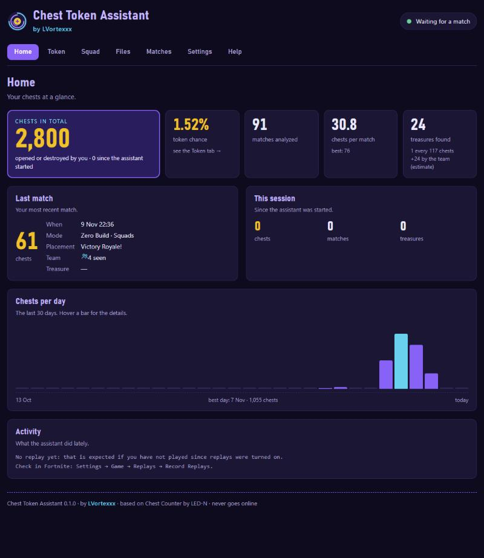
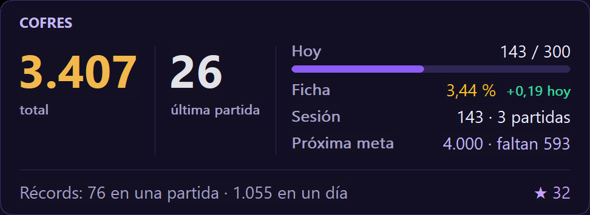
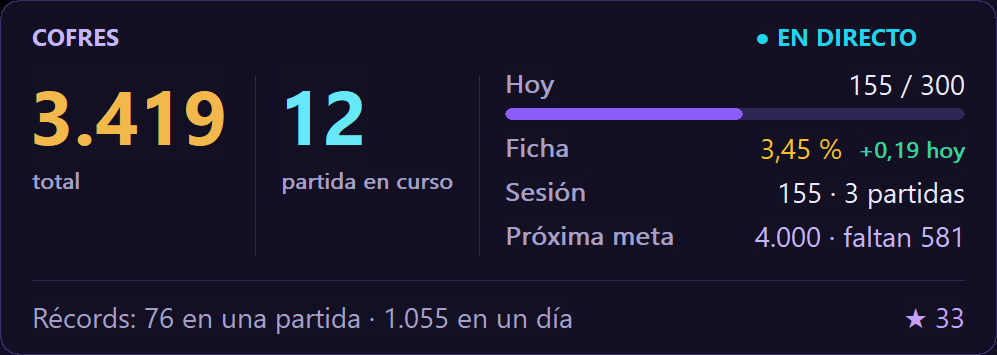

<div align="center">

[English](README.md) · [Français](README.fr.md) · [Darija](README.ary.md) · **Español**


# Chest Token Assistant

**Cuenta tus cofres de Fortnite y te dice tu probabilidad real de conseguir la ficha de la tienda pirata.**

*de LVortexxx · versión 0.1 · Windows 10 / 11 · gratis · nunca se conecta a Internet*

[](https://github.com/LVortexxx/ChestTokenAssistant/releases/latest)



</div>

---

## Qué hace

- 📦 **Cuenta cada cofre que abres**, unos segundos después de cada partida (y los que abren tus compañeros cerca de ti).
- 🎯 **Calcula tu probabilidad de la ficha de la tienda pirata** y de los tesoros semanales.
- ✅ **Una lista de cada objeto que puedes ganar** (semana 1, semana 2, toda la temporada), que se marca sola cuando tus repeticiones lo muestran.
- 👥 **Totales exactos del escuadrón**: intercambia un pequeño archivo con tus amigos.
- 🖥️ **Todo en una sola ventana** con pestañas, más un pequeño overlay sobre el juego.
- 🌍 **4 idiomas**: español, inglés, francés y darija marroquí.

## Empezar

1. En Fortnite, activa **Configuración → Juego → Repeticiones → Grabar repeticiones**.
2. Descarga **`ChestTokenAssistant.exe`** de la [última versión](https://github.com/LVortexxx/ChestTokenAssistant/releases/latest) y ábrelo (no hay nada que instalar). Si Windows dice *«Windows protegió su PC»*: *Más información → Ejecutar de todas formas*.
3. Responde a las 4 preguntas rápidas en la ventana que se abre. Listo: déjalo abierto mientras juegas.

> Cerrar la ventana **no** lo detiene: sigue contando junto al reloj (icono de ficha). Haz clic en el icono para volver a abrirlo.

## El panel

| Pestaña | En una línea |
|---|---|
| **Inicio** | Tus cofres de un vistazo: total, probabilidad de la ficha, última partida, objetivo del día, cofres por día y una imagen de estadísticas para pegar en Discord. |
| **Ficha** | Tu probabilidad de la ficha de la tienda pirata, los tesoros semanales y cuántos cofres hacen falta para cada objetivo. |
| **Objetos** | Cada objeto que puedes ganar, con su imagen, sus probabilidades y tu probabilidad; marca lo que conseguiste (se guarda). |
| **Escuadrón** | Exporta tu archivo, importa el de tus amigos y ve tus escuadrones con el recuento exacto de cada uno. |
| **Archivos** | Cada archivo de amigo que importaste, y lo que cambia. |
| **Partidas** | Cada partida, los tipos de cofre, los tesoros encontrados. |
| **Ajustes** | Idioma, objetivo del día, overlay, lo que cuenta para las probabilidades, Horas del tesoro, abrir con Fortnite. |
| **Ayuda** | Cómo funciona, tu carpeta de datos, créditos. |

Cada parte de cada pestaña tiene una explicación de una línea bajo su título.

## ¿Es seguro?

- ✅ **Solo lee** los archivos de repetición que guarda Fortnite. No modifica el juego ni accede a su memoria.
- ✅ **Nunca se conecta a Internet**. El panel es una página que el asistente muestra solo a tu propio PC (dirección `127.0.0.1` con un enlace secreto): nada de fuera de tu PC puede llegar a ella.
- ✅ Es **ligero**: prioridad baja, dormido entre partidas.

## Más detalles

<details>
<summary><b>Archivos de escuadrón</b>: cómo compartir, y qué contienen</summary>

1. **Pestaña Escuadrón → Exportar mi archivo**: `tunombre-fecha.chesttoken` aparece en tu Escritorio. Envíalo a tu escuadrón (Discord…).
2. **Importa el suyo**: haz doble clic en el archivo que te enviaron, o suéltalo en el panel.
3. Solo se guardan las partidas que jugasteis **juntos en el mismo equipo**. Su propio recuento sustituye lo que tu repetición vio de ellos, así que nada se cuenta dos veces.

**Dentro del archivo:** tu nombre y tu id de Epic, y para cada partida en equipo su id, hora, modo y tu número de cofres. Ninguna repetición, y ningún nombre ni id de otro jugador (los compañeros son códigos de un solo sentido, suficientes para reconocer «mismo equipo»).
</details>

<details>
<summary><b>La pestaña Objetos</b>: la lista</summary>

- Incluidos: **semana 1** (A$AP Rocky, G-Wagon…), **semana 2** (Lil Uzi Vert, Cadillac Blackwing…) y las recompensas de **toda la temporada** (las dos fichas de la tienda pirata y los 5 gizmos). Semanas siguientes: **+ Añadir un objeto** (nombre, tipo, fechas, probabilidades), ya que el asistente nunca se conecta a Internet para conocerlas.
- **Se marca solo** cuando tus repeticiones muestran el objeto (los premios de cofre dorado de la semana 1 y los gizmos que nombra la repetición). Desmárcalo si está mal: el asistente lo recuerda. Un premio de cofre dorado que aún no sabe nombrar aparece en la lista para que marques el correcto.
- **Tu probabilidad** de cada objeto viene de los cofres contados mientras estaba en los cofres (la misma elección que en la pestaña Ficha, Horas del tesoro incluidas).
- **Las imágenes** van dentro del exe (arte de Epic) y no se pueden cambiar; las dos pistas de improvisación y los objetos que añades llevan un icono dibujado.
- Las probabilidades marcadas con * vienen de webs de fans; las de la ficha, el vehículo y el atuendo dorado son las publicadas por Epic.
</details>

<details>
<summary><b>Cómo se calcula la probabilidad de la ficha</b></summary>

- **Probabilidad = 1 − Π(1 − m × p)** sobre cada cofre contado. *p* = probabilidad publicada por Epic (1 entre 137 500 para el Acceso a la tienda pirata), *m* = el aumento de la Hora del tesoro cuando se abrió el cofre (1 si no).
- **Cofres de los compañeros**: *vistos* en tu repetición (un mínimo), *importados* de su archivo (exactos) o *estimados* (opcional). Elige cuáles cuentan en *Ajustes → Cofres contados*.
- Las partidas clasificatorias quedan fuera por defecto (al parecer la ficha no sale ahí, sin confirmar). Los compañeros aleatorios cuentan por defecto.
</details>

<details>
<summary><b>Horas del tesoro</b> (probabilidades aumentadas)</summary>

Añádelas en **Ajustes → Horas del tesoro** (día, inicio y fin en la hora de tu PC, y los aumentos: ficha ×1,5…). Recibes una notificación 10 minutos antes y al inicio, y el encabezado del panel y el overlay muestran el aumento mientras dura. Los cofres abiertos durante una Hora del tesoro cuentan más, para la ficha y para los objetos.
</details>

<details>
<summary><b>El overlay</b></summary>

&nbsp;&nbsp;

Tres estilos (*Ajustes → Overlay en el juego*): **Ancho** (por defecto), un rectángulo con tu total, la partida actual, la barra del objetivo del día, la probabilidad de la ficha y lo que sumó el día, tu sesión, el próximo hito, y una línea para los récords (*¡Nuevo récord: 14 cofres en esta partida!*), los hitos y las Horas del tesoro; **HUD**, solo las cifras, sin fondo; **Clásico**, una tarjeta oscura. **Ctrl+Shift+O** lo muestra / oculta, **Ctrl+Shift+L** lo bloquea (el ratón lo atraviesa). Pon Fortnite en **Pantalla completa en ventana** para verlo. `overlay.html` es lo mismo para una fuente de navegador de **OBS**.
</details>

<details>
<summary><b>Tus datos</b></summary>

Todo se queda en `%APPDATA%\ChestTokenAssistant` (*Ayuda → Abrir la carpeta de datos*):

| Archivo | Contenido |
|---|---|
| `report.html` | El panel sin botones, legible incluso con el asistente cerrado. |
| `data.json` | Todo tu historial. **Haz una copia** si cambias de PC. |
| `imports.json` | Los archivos importados de tus amigos. |
| `checklist.json` · `items\` | Las marcas y objetos añadidos de la pestaña Objetos · una copia de las imágenes para `report.html`. |
| `config.json` | Tus ajustes y Horas del tesoro. |
| `matches.csv` · `overlay.html` | Una línea por partida · el overlay para OBS. |

**¿Vienes de Chest Counter?** Tu historial se mueve aquí en el primer inicio, no se pierde nada.
</details>

<details>
<summary><b>Preguntas frecuentes</b></summary>

- **No se cuenta nada.** Comprueba que las repeticiones están activadas en Fortnite y que el asistente está abierto cuando termina la partida.
- **¿Se cuentan las cajas de munición?** No. Los cofres que **destruyes** sí cuentan.
- **Mi amigo abrió más cofres de los que se muestran.** Tu repetición solo ve lo que estaba cerca de ti: importa su archivo.
- **«No se puede leer esta repetición».** Una actualización de Fortnite cambió el formato; las partidas ya contadas se conservan.
- **El panel tiene un problema.** Clic derecho en el icono de ficha → *Usar la consola (respaldo)*.
- **Una versión antigua sigue abierta o se abre con Fortnite.** Las copias antiguas de este asistente se cierran solas en cada inicio. Para ChestCounter.exe / ChestTracker.exe: *Ajustes → Detener las versiones antiguas* (o `--cleanup`) las cierra y quita su inicio con Fortnite.
- **No puedo borrar el exe.** Desactiva antes *Ajustes → Abrir con Fortnite*.
</details>

<details>
<summary><b>Línea de comandos y compilarlo tú mismo</b></summary>

```
ChestTokenAssistant.exe --console              la antigua interfaz de teclado en lugar del panel
ChestTokenAssistant.exe --lang <fr|en|ary|es>  cambiar el idioma
ChestTokenAssistant.exe --data <carpeta>       otra carpeta de datos
ChestTokenAssistant.exe --demos <carpeta>      otra carpeta de repeticiones
ChestTokenAssistant.exe --once | --odds | --files   analizar, mostrar y salir
ChestTokenAssistant.exe --export <carpeta>     exportar tu archivo .chesttoken
ChestTokenAssistant.exe --import <archivo>     importar el archivo de un amigo
ChestTokenAssistant.exe --cleanup              detener las versiones antiguas (también ChestCounter.exe) y su inicio con Fortnite
ChestTokenAssistant.exe --self-test            comprobar las probabilidades, las importaciones y el panel
```

Instala el [SDK de .NET 10](https://dotnet.microsoft.com/download/dotnet/10.0) y haz doble clic en **`build.bat`**: el exe se escribe en `dist\ChestTokenAssistant.exe`.
</details>

## Licencia y créditos

[MIT](LICENSE). Hecho por **LVortexxx**, basado en [Fortnite Chest Counter](https://github.com/LED-N/Fortnite-ChestCounter) de LED-N (MIT, aviso conservado en [`LICENSE`](LICENSE)). Lectura de repeticiones: [FortniteReplayDecompressor](https://github.com/Shiqan/FortniteReplayDecompressor) de Shiqan (MIT, ver [`lib/PATCHES.md`](lib/PATCHES.md)). Gracias a [koiseka](https://github.com/koiseka) por sus correcciones del recuento en el proyecto original.

Las imágenes de los objetos son arte de Epic Games, usadas según la [Fan Content Policy](https://www.epicgames.com/site/en-US/fan-art-policy) de Epic para esta herramienta de fans gratuita y no comercial. No está afiliado, respaldado ni patrocinado por Epic Games. Fortnite es una marca registrada de Epic Games, Inc.
