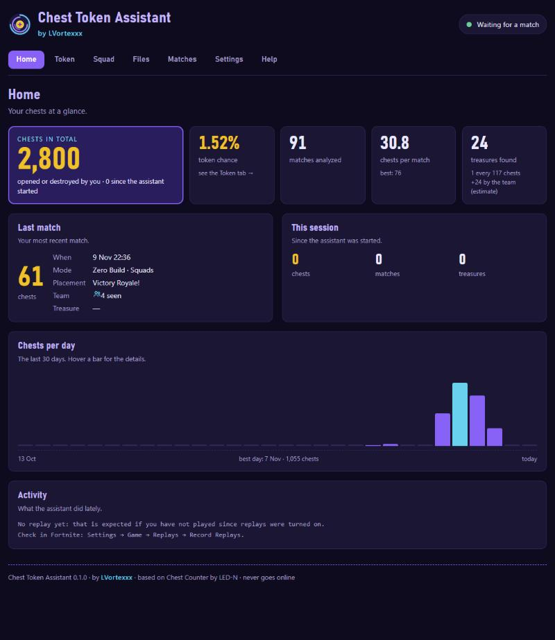
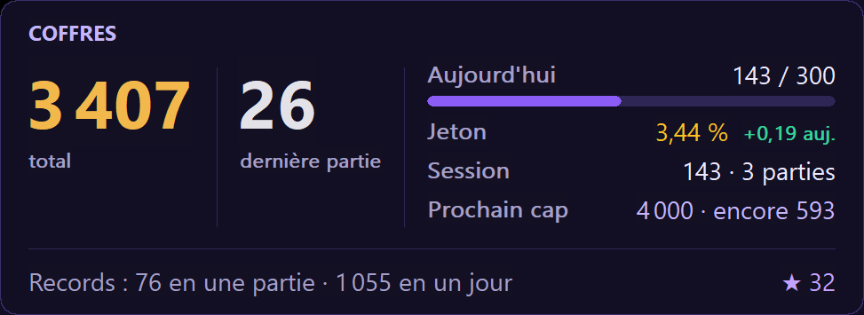
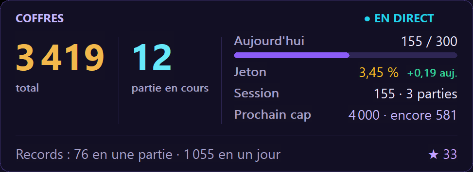

<div align="center">

[English](README.md) · **Français** · [Darija](README.ary.md) · [Español](README.es.md)


# Chest Token Assistant

**Compte tes coffres Fortnite et te donne ta vraie chance d'avoir le jeton de la boutique pirate.**

*par LVortexxx · version 0.1 · Windows 10 / 11 · gratuit · ne va jamais sur Internet*

[](https://github.com/LVortexxx/ChestTokenAssistant/releases/latest)



</div>

---

## Ce qu'il fait

- 📦 **Compte chaque coffre que tu ouvres**, quelques secondes après chaque partie (et ceux que tes coéquipiers ouvrent près de toi).
- 🎯 **Calcule ta chance d'avoir le jeton de la boutique pirate** et les trésors de la semaine.
- ✅ **Une liste de tous les objets à gagner** (semaine 1, semaine 2, toute la saison), cochés tout seuls quand tes replays les montrent.
- 👥 **Totaux exacts de l'escouade** : échange un petit fichier avec tes amis.
- 🖥️ **Tout dans une seule fenêtre** avec des onglets, plus un petit overlay par-dessus le jeu.
- 🌍 **4 langues** : français, anglais, darija marocaine et espagnol.

## Pour commencer

1. Dans Fortnite, active **Paramètres → Jeu → Rediffusions → Enregistrer les rediffusions**.
2. Télécharge **`ChestTokenAssistant.exe`** depuis la [dernière version](https://github.com/LVortexxx/ChestTokenAssistant/releases/latest) et lance-le (rien à installer). Si Windows affiche *« Windows a protégé votre ordinateur »* : *Informations complémentaires → Exécuter quand même*.
3. Réponds aux 4 petites questions dans la fenêtre qui s'ouvre. C'est tout : laisse-le tourner pendant que tu joues.

> Fermer la fenêtre ne l'arrête **pas** : il continue de compter à côté de l'horloge (icône du jeton). Clique sur l'icône pour la rouvrir.

## Le tableau de bord

| Onglet | En une ligne |
|---|---|
| **Accueil** | Tes coffres en un coup d'œil : total, chance du jeton, dernière partie, objectif du jour, coffres par jour, et une image de tes stats à coller dans Discord. |
| **Jeton** | Ta chance d'avoir le jeton, les trésors de la semaine, et combien de coffres il faut pour chaque objectif. |
| **Objets** | Chaque objet à gagner, avec son image, ses chances et ta chance ; coche ce que tu as eu (enregistré). |
| **Escouade** | Exporte ton fichier, importe celui de tes amis, et vois vos escouades avec le compte exact de chacun. |
| **Fichiers** | Chaque fichier d'ami importé, et ce qu'il change. |
| **Parties** | Chaque partie, les types de coffres, les trésors trouvés. |
| **Réglages** | Langue, objectif du jour, overlay, ce qui compte pour les chances, Heures du trésor, ouverture avec Fortnite. |
| **Aide** | Comment ça marche, ton dossier de données, les crédits. |

Chaque partie de chaque onglet a une explication d'une ligne sous son titre.

## C'est sûr ?

- ✅ Il **lit seulement** les fichiers replay que Fortnite enregistre. Aucune modification du jeu, aucun accès à sa mémoire.
- ✅ Il **ne va jamais sur Internet**. Le tableau de bord est une page que l'assistant montre à ton PC seulement (adresse `127.0.0.1` avec un lien secret) : rien en dehors de ton PC ne peut l'atteindre.
- ✅ Il est **léger** : priorité basse, endormi entre les parties.

## Plus de détails

<details>
<summary><b>Fichiers d'escouade</b> : comment partager, et ce qu'il y a dedans</summary>

1. **Onglet Escouade → Exporter mon fichier** : `ton-nom-date.chesttoken` apparaît sur ton Bureau. Envoie-le à ton escouade (Discord…).
2. **Importe le leur** : double-clique sur le fichier reçu, ou dépose-le sur le tableau de bord.
3. Seules les parties jouées **ensemble dans la même équipe** sont gardées. Leur propre compte remplace ce que ton replay a vu d'eux : rien n'est compté deux fois.

**Dans le fichier :** ton nom et ton identifiant Epic, et pour chaque partie en équipe son identifiant, son heure, son mode et ton nombre de coffres. Pas de replay, ni le nom ou l'identifiant d'un autre joueur (les coéquipiers sont des codes à sens unique, juste assez pour reconnaître « même équipe »).
</details>

<details>
<summary><b>L'onglet Objets</b> : la liste à cocher</summary>

- Inclus : la **semaine 1** (A$AP Rocky, G-Wagon…), la **semaine 2** (Lil Uzi Vert, Cadillac Blackwing…) et les récompenses de **toute la saison** (les deux jetons de la boutique pirate et les 5 gizmos). Semaines suivantes : **+ Ajouter un objet** (nom, type, dates, chances), puisque l'assistant ne va jamais sur Internet pour les connaître.
- **Coché tout seul** quand tes replays montrent l'objet (les prix des coffres dorés de la semaine 1 et les gizmos que le replay nomme). Décoche-le si c'est faux : l'assistant s'en souvient. Un prix de coffre doré qu'il ne sait pas encore nommer est signalé pour que tu coches le bon.
- **Ta chance** pour chaque objet vient des coffres comptés pendant sa période (même choix que l'onglet Jeton, Heures du trésor comprises).
- **Images** : incluses dans l'exe (illustrations d'Epic) et non modifiables ; les deux pistes musicales et les objets que tu ajoutes ont une icône dessinée.
- Les chances marquées * viennent de sites de fans ; celles du jeton, du véhicule et de la tenue dorée sont celles publiées par Epic.
</details>

<details>
<summary><b>Comment la chance du jeton est calculée</b></summary>

- **Chance = 1 − Π(1 − m × p)** sur chaque coffre compté. *p* = chances publiées par Epic (1 sur 137 500 pour l'accès à la boutique pirate), *m* = le bonus de l'Heure du trésor au moment du coffre (1 sinon).
- **Coffres des coéquipiers** : *vus* dans ton replay (un minimum), *importés* depuis leur fichier (exacts), ou *estimés* (au choix). Choisis ce qui compte dans *Réglages → Coffres comptés*.
- Les parties classées sont exclues par défaut (le jeton n'y tomberait pas, non confirmé). Les coéquipiers aléatoires comptent par défaut.
</details>

<details>
<summary><b>Heures du trésor</b> (chances augmentées)</summary>

Ajoute-les dans **Réglages → Heures du trésor** (jour, début et fin à l'heure de ton PC, et les bonus : jeton ×1,5…). Une notification arrive 10 minutes avant et au début, et l'en-tête du tableau de bord et l'overlay montrent le bonus tant qu'il dure. Les coffres ouverts pendant une Heure du trésor comptent plus, pour le jeton et pour les objets.
</details>

<details>
<summary><b>L'overlay</b></summary>

&nbsp;&nbsp;

Place-le sous la minimap. **Ctrl+Maj+O** l'affiche / le masque, **Ctrl+Maj+L** le verrouille (la souris passe au travers). Mets Fortnite en **Plein écran fenêtré** pour le voir. Trois styles (*Réglages → Overlay en jeu*) : **Large** (par défaut), un rectangle avec ton total, la partie en cours, la barre de l'objectif du jour, la chance du jeton et ce que la journée a ajouté, ta session, le prochain cap, et une ligne pour les records (*Nouveau record : 14 coffres dans cette partie !*), les caps et les Heures du trésor ; **HUD**, seulement les chiffres ; **Classique**, une carte sombre. `overlay.html` est le même pour une source navigateur **OBS**.
</details>

<details>
<summary><b>Tes données</b></summary>

Tout reste dans `%APPDATA%\ChestTokenAssistant` (*Aide → Ouvrir le dossier des données*) :

| Fichier | Contenu |
|---|---|
| `report.html` | Le tableau de bord sans boutons, lisible même quand l'assistant est fermé. |
| `data.json` | Tout ton historique. **Garde-le** si tu changes de PC. |
| `imports.json` | Les fichiers de tes amis. |
| `checklist.json` · `items\` | Les coches et objets ajoutés de l'onglet Objets · une copie des images des objets pour `report.html`. |
| `config.json` | Tes réglages et les Heures du trésor. |
| `matches.csv` · `overlay.html` | Une ligne par partie · l'overlay pour OBS. |

**Tu viens de Chest Counter ?** Ton historique est déplacé ici au premier lancement, rien n'est perdu.
</details>

<details>
<summary><b>Questions fréquentes</b></summary>

- **Rien n'est compté.** Vérifie que les rediffusions sont activées dans Fortnite et que l'assistant tourne quand la partie se termine.
- **Les caisses de munitions comptent ?** Non. Les coffres que tu **détruis** comptent.
- **Mon ami a ouvert plus de coffres qu'affiché.** Ton replay ne voit que ce qui était près de toi : importe son fichier.
- **« Impossible de lire ce replay ».** Une mise à jour de Fortnite a changé le format ; les parties déjà comptées sont gardées.
- **Le tableau de bord a un problème.** Clic droit sur l'icône du jeton → *Utiliser la console (secours)*.
- **Une ancienne version reste ouverte ou se lance avec Fortnite.** Les anciennes copies de cet assistant sont fermées toutes seules à chaque démarrage. Pour ChestCounter.exe / ChestTracker.exe : *Réglages → Arrêter les anciennes versions* (ou `--cleanup`) les ferme et retire leur lancement avec Fortnite.
- **Impossible de supprimer l'exe.** Désactive d'abord *Réglages → Ouvrir avec Fortnite*.
</details>

<details>
<summary><b>Ligne de commande et compilation</b></summary>

```
ChestTokenAssistant.exe --console              l'ancienne interface au clavier au lieu du tableau de bord
ChestTokenAssistant.exe --lang <fr|en|ary|es>  change la langue
ChestTokenAssistant.exe --data <dossier>       un autre dossier de données
ChestTokenAssistant.exe --demos <dossier>      un autre dossier de replays
ChestTokenAssistant.exe --once | --odds | --files   analyse, affiche, puis quitte
ChestTokenAssistant.exe --export <dossier>     exporte ton fichier .chesttoken
ChestTokenAssistant.exe --import <fichier>     importe le fichier d'un ami
ChestTokenAssistant.exe --cleanup              arrête les anciennes versions (ChestCounter.exe aussi) et leur lancement avec Fortnite
ChestTokenAssistant.exe --self-test            vérifie les chances, les imports et le tableau de bord
```

Installe le [SDK .NET 10](https://dotnet.microsoft.com/download/dotnet/10.0), puis double-clique sur **`build.bat`** : l'exe est écrit dans `dist\ChestTokenAssistant.exe`.
</details>

## Licence et crédits

[MIT](LICENSE). Fait par **LVortexxx**, basé sur [Fortnite Chest Counter](https://github.com/LED-N/Fortnite-ChestCounter) de LED-N (MIT, mention conservée dans [`LICENSE`](LICENSE)). Lecture des replays : [FortniteReplayDecompressor](https://github.com/Shiqan/FortniteReplayDecompressor) de Shiqan (MIT, voir [`lib/PATCHES.md`](lib/PATCHES.md)). Merci à [koiseka](https://github.com/koiseka) pour ses corrections du comptage dans le projet d'origine.

Les images des objets sont des œuvres d'Epic Games, utilisées selon la [politique de contenu des fans](https://www.epicgames.com/site/en-US/fan-art-policy) d'Epic pour cet outil de fan gratuit et non commercial. Ce projet n'est ni affilié, ni approuvé, ni sponsorisé par Epic Games. Fortnite est une marque d'Epic Games, Inc.
