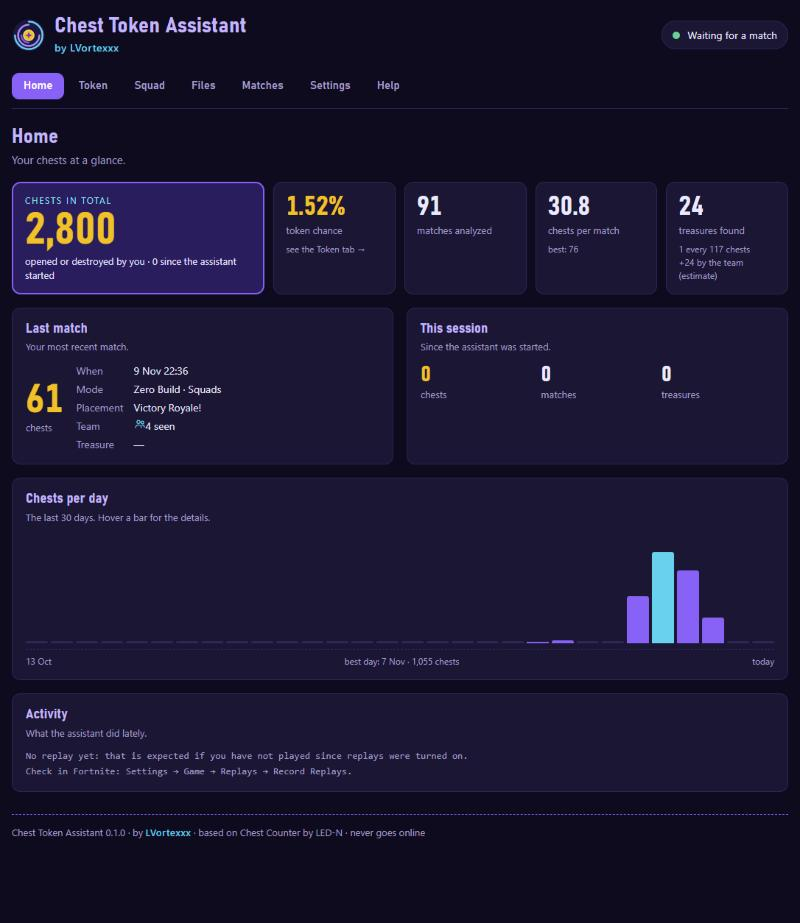
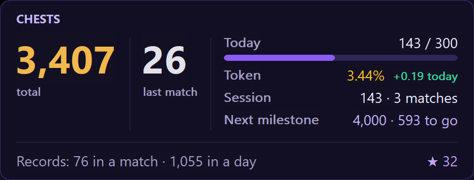
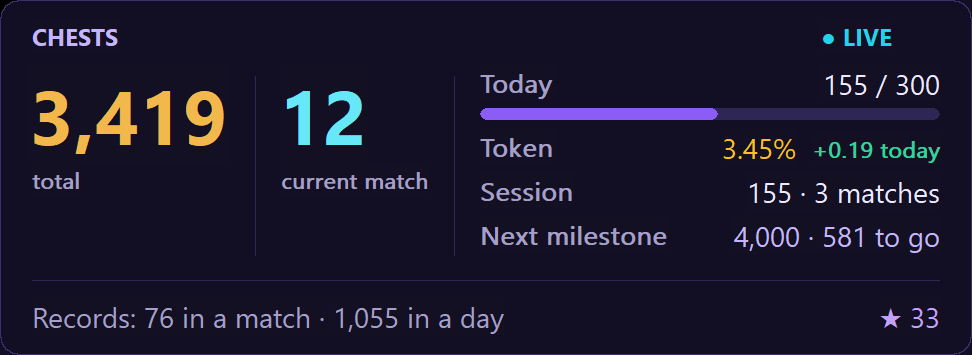

<div align="center">

**English** · [Français](README.fr.md) · [Darija](README.ary.md) · [Español](README.es.md)


# Chest Token Assistant

**Counts your Fortnite chests and tells you your real chance of the Pirate Shop token.**

*by LVortexxx · version 0.1 · Windows 10 / 11 · free · never goes online*

[](https://github.com/LVortexxx/ChestTokenAssistant/releases/latest)



</div>

---

## What it does

- 📦 **Counts every chest you open**, a few seconds after each match (and the ones your teammates open near you).
- 🎯 **Works out your chance of the Pirate Shop token** and of the weekly treasures.
- ✅ **A checklist of every item you can win** (week 1, week 2, all season), ticked by itself when your replays show it.
- 👥 **Exact squad totals**: swap a small file with your friends.
- 🖥️ **Everything in one window** with tabs, plus a small overlay over the game.
- 🌍 **4 languages**: English, French, Moroccan Darija and Spanish.

## Get started

1. In Fortnite, turn on **Settings → Game → Replays → Record Replays**.
2. Download **`ChestTokenAssistant.exe`** from the [latest release](https://github.com/LVortexxx/ChestTokenAssistant/releases/latest) and run it (nothing to install). If Windows says *"Windows protected your PC"*: *More info → Run anyway*.
3. Answer the 4 quick questions in the window that opens. Done: keep it running while you play.

> Closing the window does **not** stop it: it keeps counting next to the clock (token icon). Click the icon to open it again.

## The dashboard

| Tab | In one line |
|---|---|
| **Home** | Your chests at a glance: total, token chance, last match, today's goal, chests per day, and a stats image to paste in Discord. |
| **Token** | Your chance of the Pirate Shop token, the weekly treasures, and how many chests each goal takes. |
| **Items** | Every item you can win, with its picture, odds and your chance; tick what you got (saved). |
| **Squad** | Export your file, import your friends', and see your squads with everyone's exact count. |
| **Files** | Each friend's file you imported, and what it changes. |
| **Matches** | Every match, chest types, treasures found. |
| **Settings** | Language, daily goal, overlay, what counts for the odds, Treasure Hours, open with Fortnite. |
| **Help** | How it works, your data folder, credits. |

Every part of every tab has a one-line explanation under its title.

## Is it safe?

- ✅ It **only reads** the replay files Fortnite saves. No game modification, no access to the game's memory.
- ✅ It **never goes online**. The dashboard is a page the assistant shows to your own PC only (address `127.0.0.1` with a secret link): nothing outside your PC can reach it.
- ✅ It is **light**: low priority, asleep between matches.

## More details

<details>
<summary><b>Squad files</b>: how to share, and what's inside</summary>

1. **Squad tab → Export my file**: `yourname-date.chesttoken` appears on your Desktop. Send it to your squad (Discord…).
2. **Import theirs**: double-click the file they sent, or drop it on the dashboard.
3. Only the matches you played **together on the same team** are kept. Their own count replaces what your replay saw of them, so nothing is counted twice.

**Inside the file:** your name and Epic id, and for each team match its id, time, mode and your chest count. No replay, and no other player's name or id (teammates are one-way codes, enough to recognise "same team").
</details>

<details>
<summary><b>The Items tab</b>: the checklist</summary>

- Built in: **week 1** (A$AP Rocky, G-Wagon…), **week 2** (Lil Uzi Vert, Cadillac Blackwing…) and the **all-season** rewards (the two Pirate Shop tokens and the 5 gizmos). Later weeks: **+ Add an item** (name, type, dates, odds), since the assistant never goes online to learn them.
- **Ticks itself** when your replays show the item (week 1's golden chest prizes and the gizmos the replay names). Untick it if it's wrong: the assistant remembers. A golden chest prize it can't name yet is listed so you can tick the right one.
- **Your chance** of each item comes from the chests counted while it was in the chests (same choice as the Token tab, Treasure Hours included).
- **Pictures** are built into the exe (Epic's art) and can't be changed; the two jam tracks and the items you add get a drawn icon.
- Odds marked * come from fan sites; the token, vehicle and gold outfit odds are Epic's published ones.
</details>

<details>
<summary><b>How the token chance is worked out</b></summary>

- **Chance = 1 − Π(1 − m × p)** over every chest counted. *p* = Epic's published odds (1 in 137,500 for Pirate Shop Access), *m* = the Treasure Hour boost when the chest was opened (1 otherwise).
- **Teammates' chests**: *seen* in your replay (a minimum), *imported* from their file (exact), or *estimated* (optional). Choose which ones count in *Settings → Chests counted*.
- Ranked matches are left out by default (the token reportedly does not drop there, unconfirmed). Random teammates count by default.
</details>

<details>
<summary><b>Treasure Hours</b> (boosted odds)</summary>

Add them in **Settings → Treasure Hours** (day, start and end in your PC's time, and the boosts: token ×1.5…). You get a notification 10 minutes before and at the start, and the dashboard header and the overlay show the boost while it lasts. Chests opened during a Treasure Hour count for more, for the token and for the items.
</details>

<details>
<summary><b>The overlay</b></summary>

&nbsp;&nbsp;

Three styles (*Settings → In-game overlay*): **Wide** (default), a rectangle with your total, the current match, today's goal bar, the token chance and what today added, your session, the next milestone, and a line for records (*New record: 14 chests this match!*), milestones and Treasure Hours; **HUD**, only the figures, no background; **Classic**, a dark card. **Ctrl+Shift+O** shows / hides it, **Ctrl+Shift+L** locks it (the mouse goes through). Set Fortnite to **Windowed Fullscreen** to see it. `overlay.html` is the same for an **OBS** browser source.
</details>

<details>
<summary><b>Your data</b></summary>

Everything stays in `%APPDATA%\ChestTokenAssistant` (*Help → Open the data folder*):

| File | Content |
|---|---|
| `report.html` | The dashboard without buttons, readable even when the assistant is closed. |
| `data.json` | Your whole history. **Back it up** if you change PC. |
| `imports.json` | Your friends' imported files. |
| `checklist.json` · `items\` | The Items tab's ticks and added items · a copy of the items' pictures for `report.html`. |
| `config.json` | Your settings and Treasure Hours. |
| `matches.csv` · `overlay.html` | One line per match · the OBS overlay. |

**Coming from Chest Counter?** Your history is moved here at the first start, nothing is lost.
</details>

<details>
<summary><b>FAQ</b></summary>

- **Nothing is counted.** Check that replays are on in Fortnite and that the assistant is running when the match ends.
- **Are ammo boxes counted?** No. Chests you **destroy** count.
- **My friend opened more chests than shown.** Your replay only sees what was near you: import their file.
- **"Cannot read this replay".** A Fortnite update changed the format; matches already counted are kept.
- **The dashboard has a problem.** Right-click the token icon → *Use the console (backup)*.
- **An old version keeps running or opening with Fortnite.** Older copies of this assistant are closed by themselves at each start. For ChestCounter.exe / ChestTracker.exe: *Settings → Stop old versions* (or `--cleanup`) closes them and removes their start with Fortnite.
- **Cannot delete the exe.** Turn off *Settings → Open with Fortnite* first.
</details>

<details>
<summary><b>Command line and building it yourself</b></summary>

```
ChestTokenAssistant.exe --console              the old keyboard interface instead of the dashboard
ChestTokenAssistant.exe --lang <fr|en|ary|es>  change the language
ChestTokenAssistant.exe --data <folder>        another data folder
ChestTokenAssistant.exe --demos <folder>       another replays folder
ChestTokenAssistant.exe --once | --odds | --files   analyze, print, then quit
ChestTokenAssistant.exe --export <folder>      export your .chesttoken file
ChestTokenAssistant.exe --import <file>        import a friend's file
ChestTokenAssistant.exe --cleanup              stop old versions (ChestCounter.exe too) and their start with Fortnite
ChestTokenAssistant.exe --self-test            check the odds, the imports and the dashboard
```

Install the [.NET 10 SDK](https://dotnet.microsoft.com/download/dotnet/10.0), then double-click **`build.bat`**: the exe is written to `dist\ChestTokenAssistant.exe`.
</details>

## License and credits

[MIT](LICENSE). Made by **LVortexxx**, based on [Fortnite Chest Counter](https://github.com/LED-N/Fortnite-ChestCounter) by LED-N (MIT, notice kept in [`LICENSE`](LICENSE)). Replay reading: [FortniteReplayDecompressor](https://github.com/Shiqan/FortniteReplayDecompressor) by Shiqan (MIT, see [`lib/PATCHES.md`](lib/PATCHES.md)). Thanks to [koiseka](https://github.com/koiseka) for their counting fixes in the original project.

Item pictures are Epic Games' art, used under Epic's [Fan Content Policy](https://www.epicgames.com/site/en-US/fan-art-policy) for this free, non-commercial fan tool. Not affiliated with, endorsed or sponsored by Epic Games. Fortnite is a trademark of Epic Games, Inc.
